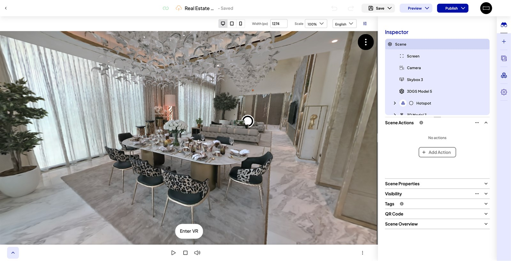

# Cyango for LichtFeld Studio

Publish Gaussian splat scenes from [LichtFeld Studio](https://lichtfeld.io/) to [Cyango](https://cyango.com/). The plugin exports the splats in your scene and uploads them to your Cyango workspace. Cyango makes a private story with the splat. Then you add hotspots, UI and actions in the Cyango app.

## Get the Cyango app

Use the Cyango desktop app to make your token and to edit the stories that the plugin publishes.

| System | Download |
|--------|----------|
| Windows | [Microsoft Store](https://apps.microsoft.com/detail/9NJTVMGRN0LM) |
| macOS | [cyango.com/download](https://cyango.com/download) |

The Cyango app can be on a different computer from LichtFeld Studio. There is no Cyango app for Linux. On Linux, use [Cyango Studio](https://studio.cyango.com) in a web browser.

## Install the plugin

You need LichtFeld Studio 0.5.3 or later.

1. Open the **Plugins** panel.
2. Enter `https://github.com/joaomelorodrigues/cyango-lichtfeld-plugin`.
3. Select **Install**.
4. If the plugin does not start, select **Load**. You can also turn on **Load on Startup**.

The **Cyango** tab shows in the main workspace.

## Connect your Cyango account

1. Open the Cyango app and sign in.
2. Open **Account settings > External publish tokens**.
3. Make a token, for example "LichtFeld on my PC". Copy it. Cyango shows it one time only.
4. In the **Cyango** tab in LichtFeld Studio, paste the token.
5. Optional: select **Store securely with your operating system**. Then select **Connect**.

The token publishes into the workspace that was active when you made it. To stop the plugin, revoke the token in the Cyango app. The plugin keeps the token only in the operating system credential store, never in a plain text file.

## Publish a scene

1. Open a scene with at least one splat node.
2. In the **Cyango** tab, select **All splats** or **Visible splats**.
3. Enter a title. A description is optional.
4. Optional: select an asset folder. The default is "My Uploads".
5. Optional: open **Advanced** to change the file format, the SH degree and the number of parallel parts.
6. Select **Publish to Cyango**.
7. When the upload is complete, open the Cyango app. The new story is on the **Stories** page.

Cyango converts the splat in the background. The story stays private until you publish it. On a computer without the Cyango app, **Open in Cyango Studio** opens the story in a web browser.

If an upload stops after the export, the panel shows **Resume**. The plugin then sends only the missing parts. Select **Discard** to delete the staged export.

### File formats

| Format | Use |
|--------|-----|
| SPZ (default) | Compact and almost lossless. Best for most scenes. |
| PLY | Lossless, but the largest upload. |
| SOG | The smallest upload, with lossy compression. |

Cyango converts every format for its player, so the format changes the upload size, not what you can do in Cyango.

## Development

See the [development guide](docs/development.md).

## License

MIT. See [LICENSE](LICENSE) and [THIRD_PARTY_NOTICES.md](THIRD_PARTY_NOTICES.md).
